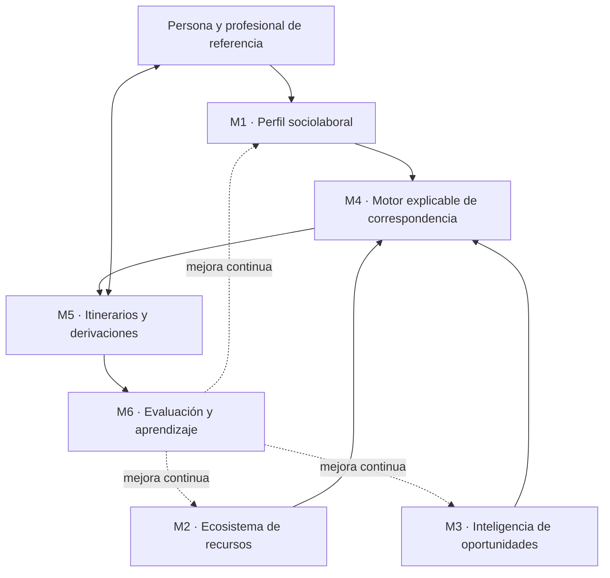

<div align="center">

# SIIS-PcD
## Sistema Inteligente de Itinerarios de Inserción Sociolaboral para Personas con Discapacidad

**Infraestructura digital de orientación, intermediación, derivación y seguimiento sociolaboral**

[](#estado-del-proyecto)
[](#control-de-versiones)
[](#%C3%A1mbito-de-aplicaci%C3%B3n)
[](#licencia-y-reutilizaci%C3%B3n)

**Documento fundacional · Propuesta v0.1 · Noviembre de 2026**

</div>

> [!IMPORTANT]
> **Principio fundacional:** la unidad fundamental del sistema no es la oferta laboral, sino la trayectoria sociolaboral de la persona. La tecnología debe contribuir a identificar oportunidades, hacer visibles las barreras y facilitar los apoyos necesarios para ejercer el derecho al trabajo en condiciones de igualdad.

---

## Índice

- [1. Resumen ejecutivo](#1-resumen-ejecutivo)
- [2. Identidad y delimitación del proyecto](#2-identidad-y-delimitación-del-proyecto)
- [3. Hipótesis central y problema](#3-hipótesis-central-y-problema)
- [4. Propósito, objetivos y resultados esperados](#4-propósito-objetivos-y-resultados-esperados)
- [5. Principios rectores](#5-principios-rectores)
- [6. Arquitectura funcional](#6-arquitectura-funcional)
  - [M1. Perfil sociolaboral individual](#m1-perfil-sociolaboral-individual)
  - [M2. Ecosistema de recursos](#m2-ecosistema-de-recursos)
  - [M3. Inteligencia de oportunidades](#m3-inteligencia-de-oportunidades)
  - [M4. Motor de correspondencia explicable](#m4-motor-de-correspondencia-explicable)
  - [M5. Itinerarios y derivaciones](#m5-itinerarios-y-derivaciones)
  - [M6. Evaluación y aprendizaje](#m6-evaluación-y-aprendizaje)
- [7. Modelo de datos inicial](#7-modelo-de-datos-inicial)
- [8. Inteligencia artificial: funciones y límites](#8-inteligencia-artificial-funciones-y-límites)
- [9. MVP: primera versión viable](#9-mvp-primera-versión-viable)
- [10. Evaluación científica y falsabilidad](#10-evaluación-científica-y-falsabilidad)
- [11. Plan de desarrollo](#11-plan-de-desarrollo)
- [12. Protección de datos y gobernanza](#12-protección-de-datos-y-gobernanza)
- [13. Estrategia de transferencia](#13-estrategia-de-transferencia)
- [14. Riesgos, límites y cuestiones abiertas](#14-riesgos-límites-y-cuestiones-abiertas)
- [15. Repositorio y reproducibilidad](#15-repositorio-y-reproducibilidad)
- [16. Referencias y marco normativo](#16-referencias-y-marco-normativo)
- [17. Control de versiones](#17-control-de-versiones)

---

## 1. Resumen ejecutivo

El **Sistema Inteligente de Itinerarios de Inserción Sociolaboral para Personas con Discapacidad (SIIS-PcD)** es una propuesta de innovación sociolaboral y tecnología asistencial cuyo propósito es diseñar, desarrollar y evaluar una infraestructura digital de apoyo a la orientación, intermediación, derivación y seguimiento de personas con discapacidad.

El proyecto parte de una observación operativa: los perfiles personales, las ofertas laborales, los recursos especializados, la formación y los apoyos posteriores a la contratación suelen gestionarse mediante procedimientos y fuentes de información fragmentados. Esa fragmentación puede dificultar la continuidad de los itinerarios y la identificación de oportunidades compatibles con las capacidades, preferencias y necesidades de apoyo de cada persona.

SIIS-PcD no pretende convertirse en otro portal de empleo ni en un sistema automatizado de selección. Su función será apoyar a los profesionales para que puedan:

1. Construir y actualizar perfiles sociolaborales centrados en la persona.
2. Localizar recursos, entidades, empresas y oportunidades.
3. Analizar los requisitos y las condiciones de accesibilidad de las ofertas.
4. Proponer correspondencias explicables entre personas, puestos y apoyos.
5. Registrar acciones, derivaciones, candidaturas y resultados.
6. Evaluar la evolución de los itinerarios y la permanencia en el empleo.

La primera etapa se plantea como un prototipo de alcance reducido, susceptible de pilotaje en una entidad social de Tenerife, con supervisión profesional, participación voluntaria y garantías de protección de datos.

## 2. Identidad y delimitación del proyecto

| Elemento | Definición |
|---|---|
| Nombre | SIIS-PcD |
| Denominación | Sistema Inteligente de Itinerarios de Inserción Sociolaboral para Personas con Discapacidad |
| Naturaleza | Proyecto de innovación sociolaboral y tecnología asistencial |
| Ámbito inicial | Tenerife, Canarias, España |
| Entorno de pilotaje propuesto | Fundación Sonsoles Soriano, sujeto a acuerdo institucional |
| Versión documental | 0.1.0 |
| Estado | Propuesta fundacional; pendiente de validación y gobernanza |
| Tipo de sistema | Herramienta de apoyo profesional, no sistema de decisión automatizada |

### 2.1. Separación respecto al proyecto formativo Indeed

SIIS-PcD debe mantener identidad, metodología, objetivos, código y gobernanza propios, diferenciándose del proyecto formativo sobre Indeed.

| Proyecto formativo Indeed | SIIS-PcD |
|---|---|
| Enseñar a utilizar herramientas digitales para buscar empleo. | Coordinar orientación, intermediación, derivación y seguimiento. |
| Unidad de intervención: actividad formativa y aprendizaje del participante. | Unidad de intervención: trayectoria sociolaboral de la persona. |
| Resultado inmediato: mayor autonomía en el uso de herramientas de búsqueda. | Resultado esperado: itinerarios mejor coordinados, trazables y adaptados. |
| Recurso didáctico. | Infraestructura de apoyo a profesionales y entidades. |

La experiencia formativa puede aportar conocimiento sobre accesibilidad, barreras digitales y necesidades de apoyo, pero no debe confundirse con el desarrollo del sistema.

### 2.2. Relación con otras líneas de trabajo

Podrán estudiarse sinergias metodológicas con GCD-EDU —por ejemplo, adaptación cognitiva, diseño didáctico y evaluación—, manteniendo SIIS-PcD como proyecto autónomo. Cualquier reutilización de componentes deberá documentarse y respetar sus respectivas licencias, finalidades y condiciones de gobernanza.

## 3. Hipótesis central y problema

### 3.1. Problema identificado

La inserción sociolaboral no depende exclusivamente de la existencia de ofertas. Intervienen, al menos, seis dimensiones conectadas:

- Capacidades, experiencia, intereses y preferencias de la persona.
- Requisitos formales y funcionales de los puestos.
- Recursos de orientación e intermediación disponibles.
- Acceso a formación y oportunidades de aprendizaje.
- Adaptaciones y apoyos requeridos para incorporarse y desarrollar el trabajo.
- Acompañamiento y seguimiento posteriores a la contratación.

Cuando estas dimensiones se gestionan de forma aislada, pueden perderse oportunidades, repetirse evaluaciones, demorarse derivaciones o interrumpirse el acompañamiento.

### 3.2. Hipótesis de trabajo

> Una infraestructura de información y coordinación, centrada en la trayectoria sociolaboral y dotada de mecanismos explicables de correspondencia, puede reducir la fragmentación de los itinerarios y mejorar la identificación y gestión de oportunidades compatibles con las capacidades, preferencias y apoyos de cada persona.

Esta hipótesis no presupone que la tecnología elimine las barreras estructurales del mercado laboral. El sistema pretende hacerlas visibles, medibles y abordables, sin trasladar a la persona la responsabilidad de corregirlas.

### 3.3. Tres realidades que el sistema conecta

1. **La persona:** capacidades, preferencias, experiencia, objetivos, autonomía y necesidades de apoyo.
2. **El ecosistema:** empresas, Centros Especiales de Empleo (CEE), entidades de intermediación, recursos públicos, formación y servicios de empleo con apoyo.
3. **El itinerario:** orientación, preparación, derivación, candidatura, selección, incorporación, adaptación y permanencia.

## 4. Propósito, objetivos y resultados esperados

### 4.1. Propósito

Desarrollar una infraestructura digital de apoyo a la orientación, intermediación y seguimiento sociolaboral de personas con discapacidad, basada en la correspondencia entre capacidades individuales, preferencias profesionales, oportunidades laborales y necesidades de apoyo.

### 4.2. Objetivo general

Diseñar, desarrollar y evaluar un sistema digital explicable que facilite la construcción de itinerarios individualizados de inserción sociolaboral, mejore la coordinación entre entidades y permita evaluar los resultados de las intervenciones.

### 4.3. Objetivos específicos

- Estructurar perfiles sociolaborales centrados en la persona.
- Construir un directorio mantenible de recursos, entidades y empresas.
- Registrar y analizar oportunidades laborales y formativas.
- Diferenciar requisitos obligatorios, requisitos definidos por la empresa y elementos deseables.
- Proponer correspondencias justificadas entre capacidades, preferencias, puestos y apoyos.
- Facilitar la gestión de acciones, derivaciones y seguimiento.
- Medir resultados, accesibilidad, satisfacción y posibles efectos no deseados.

### 4.4. Resultado esperado

Un prototipo funcional, evaluable y transferible que permita a entidades sociales y profesionales de orientación gestionar itinerarios sociolaborales con mayor trazabilidad, accesibilidad y capacidad de adaptación.

## 5. Principios rectores

1. **Centralidad de la persona:** la persona participa en la definición de sus objetivos y conserva el control sobre sus decisiones.
2. **Autonomía y autodeterminación:** las recomendaciones no sustituyen la voluntad ni las preferencias individuales.
3. **Accesibilidad cognitiva y digital:** la información, los formularios y los procedimientos deben poder comprenderse y utilizarse con los apoyos necesarios.
4. **Diseño universal:** se priorizan soluciones utilizables por el mayor número posible de personas, sin excluir ajustes individuales.
5. **Correspondencia basada en capacidades:** se consideran competencias demostradas, experiencia formal y no formal, intereses y potencial de aprendizaje.
6. **Apoyos individualizados:** las necesidades de apoyo se describen funcionalmente y en relación con tareas y contextos concretos.
7. **Transparencia algorítmica:** cada recomendación debe explicar qué factores la sustentan y qué información falta.
8. **Supervisión humana:** las decisiones relevantes corresponden a la persona y a los profesionales responsables, dentro de sus competencias.
9. **Protección de datos:** se aplican minimización, limitación de finalidad, seguridad y control de acceso.
10. **Evaluación empírica:** las mejoras se medirán frente a procedimientos de referencia y podrán ser refutadas.

## 6. Arquitectura funcional

La arquitectura inicial se organiza en seis módulos interconectados.



> [!NOTE]
> El diagrama representa una arquitectura conceptual. No implica que los módulos estén desarrollados ni que exista ya una integración técnica entre ellos.

### M1. Perfil sociolaboral individual

Recoge información relevante para construir un itinerario individualizado:

- Competencias y habilidades.
- Preferencias, intereses y objetivos.
- Experiencia laboral, formativa y no formal.
- Tareas que la persona realiza de forma autónoma.
- Apoyos que pueden facilitar el aprendizaje o el desempeño.
- Adaptaciones y formatos accesibles.
- Disponibilidad, movilidad y condiciones de participación.

El perfil deberá ser revisable y validado con la persona. No se construirá como una etiqueta permanente ni como una puntuación global de empleabilidad.

### M2. Ecosistema de recursos

Directorio estructurado y mantenible de:

- Centros Especiales de Empleo y otras entidades empleadoras.
- Servicios públicos de empleo y recursos de orientación.
- Entidades de intermediación e inclusión laboral.
- Recursos de empleo con apoyo.
- Empresas ordinarias y organizaciones colaboradoras.
- Formación, acreditación de competencias y recursos comunitarios.

Cada registro debería incluir fuente, fecha de verificación, ámbito territorial, servicios, criterios de acceso, contacto institucional y condiciones de derivación, cuando estén disponibles.

### M3. Inteligencia de oportunidades

Permite incorporar y analizar ofertas de empleo, prácticas, formación y otras oportunidades.

El análisis debería identificar:

- Funciones y tareas reales del puesto.
- Requisitos obligatorios y deseables.
- Titulación y experiencia solicitadas.
- Jornada, horario, ubicación y desplazamiento.
- Condiciones de accesibilidad conocidas.
- Posibles adaptaciones o apoyos que convendría consultar.
- Fecha de publicación y estado de vigencia de la oportunidad.

El sistema deberá distinguir entre requisitos legales, requisitos establecidos por la empresa y elementos descriptivos o preferentes. No deberá eliminar requisitos legítimos ni declarar discriminatoria una oferta de forma automática.

### M4. Motor de correspondencia explicable

Es uno de los elementos diferenciales del proyecto.

Los portales convencionales suelen priorizar coincidencias entre palabras clave, experiencia y requisitos declarados. SIIS-PcD propone ampliar esa lógica mediante una correspondencia contextual entre:

- Capacidades y competencias demostradas.
- Preferencias e intereses de la persona.
- Tareas esenciales del puesto.
- Condiciones del entorno laboral.
- Posibilidades de aprendizaje.
- Adaptaciones y apoyos potencialmente disponibles.

**Ejemplo de uso:** una persona interesada en actividades manuales puede no reunir experiencia laboral previa en un puesto de producción artesanal. El sistema podría señalar competencias manipulativas descritas en su perfil, interés por ese tipo de actividad y la posibilidad de aprendizaje mediante demostración práctica. También indicaría qué requisitos faltan por verificar y qué apoyos sería necesario consultar.

La salida no será «apto/no apto». Será una propuesta argumentada para que la persona y el profesional valoren si tiene sentido explorar la oportunidad.

Cada recomendación debería mostrar:

1. Factores de coincidencia.
2. Preferencias consideradas.
3. Requisitos no acreditados o pendientes de verificar.
4. Barreras identificadas.
5. Apoyos o adaptaciones que podrían explorarse.
6. Calidad y antigüedad de los datos utilizados.
7. Motivo por el que se recomienda revisar —o no priorizar— la oportunidad.

### M5. Itinerarios y derivaciones

Registra la secuencia de acciones acordadas con la persona:

- Orientación y definición de objetivos.
- Formación y desarrollo de competencias.
- Preparación de candidaturas.
- Contactos y derivaciones a recursos.
- Entrevistas y procesos de selección.
- Incorporación y apoyos iniciales.
- Seguimiento y revisión del itinerario.

Las derivaciones deberán registrar su motivo, entidad de destino, fecha, consentimiento o base jurídica aplicable, estado y resultado conocido.

### M6. Evaluación y aprendizaje

Integra indicadores de proceso y resultado para conocer:

- Tiempo y esfuerzo necesarios para localizar recursos.
- Calidad y pertinencia de las correspondencias.
- Derivaciones realizadas y efectivas.
- Acceso a entrevistas y oportunidades.
- Contratación y permanencia.
- Satisfacción y experiencia de las personas participantes.
- Accesibilidad y carga administrativa para profesionales.
- Diferencias de resultados entre grupos, cuando su análisis sea lícito, necesario y metodológicamente adecuado.

## 7. Modelo de datos inicial

Cada participante dispondrá de un expediente sociolaboral estructurado, sujeto a minimización de datos y permisos de acceso.

| Dimensión | Variables orientativas |
|---|---|
| Identificación | Identificador interno; datos identificativos mínimos cuando sean necesarios |
| Competencias | Digitales, manipulativas, comunicativas, sociales y funcionales |
| Preferencias | Actividades, sectores, tareas y entornos de trabajo |
| Experiencia | Laboral, formativa, voluntariado y experiencia no formal |
| Autonomía | Tareas que realiza y condiciones en las que las realiza |
| Apoyos | Tipo, intensidad contextual y duración estimada del apoyo |
| Accesibilidad | Adaptaciones, formatos y condiciones de comunicación |
| Disponibilidad | Horarios, movilidad y desplazamientos |
| Itinerario | Objetivos, acciones, responsables, derivaciones y fechas |
| Resultados | Entrevistas, candidaturas, contratación y permanencia |

> [!WARNING]
> El diagnóstico médico no debe utilizarse como sustituto de una descripción funcional ni convertirse en una puntuación de empleabilidad. Las necesidades de apoyo se registrarán en términos funcionales, pertinentes para el itinerario y con las garantías jurídicas correspondientes.

### 7.1. Separación de información

Se recomienda separar, lógica y técnicamente cuando proceda:

- Datos identificativos.
- Información sociolaboral.
- Información relativa a apoyos y accesibilidad.
- Registro de actividad y auditoría.
- Datos agregados para evaluación.

El acceso se limitará según funciones profesionales y necesidad efectiva. Los datos de evaluación deberán anonimizarse o seudonimizarse cuando corresponda, teniendo presente que la seudonimización no equivale a anonimización.

## 8. Inteligencia artificial: funciones y límites

La IA debe ayudar a los profesionales a trabajar mejor; no debe decidir quién merece trabajar.

| Función | Aplicación prevista | Límite |
|---|---|---|
| Análisis semántico | Interpretar descripciones de ofertas | No sustituye la comprobación de la fuente |
| Extracción de requisitos | Separar requisitos obligatorios, empresariales y deseables | La clasificación requiere validación |
| Detección de barreras | Señalar exigencias que podrían dificultar el acceso | No declara automáticamente que exista discriminación |
| Correspondencia | Proponer oportunidades compatibles y explicar por qué | No emite decisiones de aptitud o exclusión |
| Adaptación cognitiva | Simplificar ofertas y procedimientos | Debe preservar el significado y permitir revisión |
| Orientación | Sugerir recursos o acciones formativas | La decisión se acuerda con la persona |
| Seguimiento | Identificar acciones pendientes o itinerarios estancados | No sustituye el contacto profesional |

### 8.1. Requisitos de explicabilidad

Toda recomendación generada deberá poder responder:

- ¿Qué datos se han utilizado?
- ¿Qué factores han contribuido a la recomendación?
- ¿Qué información no estaba disponible?
- ¿Qué requisitos no se han podido verificar?
- ¿Qué alternativas podrían considerarse?
- ¿Cómo puede la persona o el profesional corregir la información?

### 8.2. Límites de automatización

Quedan fuera del propósito del sistema:

- Clasificar a las personas mediante una puntuación global de valor o empleabilidad.
- Excluir automáticamente candidaturas.
- Inferir capacidades a partir de diagnósticos o categorías de discapacidad.
- Enviar candidaturas o datos a terceros sin autorización y base jurídica adecuadas.
- Sustituir la valoración profesional o la autodeterminación de la persona.
- Presentar como hechos datos extraídos por IA que no hayan sido verificados.

## 9. MVP: primera versión viable

El desarrollo inicial debe ser deliberadamente pequeño. El objetivo es comprobar si la herramienta mejora el trabajo real de orientación antes de ampliar su complejidad.

### 9.1. Funciones mínimas

1. Crear y actualizar un perfil sociolaboral.
2. Registrar recursos y entidades de empleo.
3. Introducir y estructurar ofertas laborales.
4. Generar correspondencias explicadas mediante reglas transparentes.
5. Registrar derivaciones, acciones y resultados.

### 9.2. Tecnologías posibles

| Componente | Tecnología candidata | Observaciones |
|---|---|---|
| Base de datos | SQLite / PostgreSQL | SQLite para prototipo; PostgreSQL si se requiere concurrencia y despliegue |
| Interfaz | Streamlit | Adecuada para validar flujos con profesionales |
| Procesamiento | Python | Lógica de negocio y tratamiento de datos |
| Análisis de ofertas | NLP / LLM | Uso opcional, con validación y control de datos |
| Correspondencia | Reglas explicables | Primera opción antes de modelos predictivos |
| Panel profesional | Dashboard | Indicadores de proceso y seguimiento |
| Informes | PDF / CSV | Exportación controlada y minimizada |

### 9.3. Criterio de construcción

Primero se implementarán formularios, registros y reglas explícitas. La IA se incorporará únicamente cuando exista una necesidad funcional demostrada y se haya evaluado su utilidad, riesgo y coste.

No se automatizarán candidaturas ni se transmitirán datos personales a servicios externos sin autorización, base jurídica y garantías adecuadas.

## 10. Evaluación científica y falsabilidad

El proyecto debe someterse a evaluación verificable. No se considerará exitoso por el mero hecho de que el prototipo funcione técnicamente.

### 10.1. Hipótesis evaluables

- **H1:** el sistema reduce el tiempo necesario para localizar recursos adecuados.
- **H2:** mejora la correspondencia entre preferencias, capacidades y oportunidades.
- **H3:** aumenta la proporción de derivaciones que culminan en procesos de selección.
- **H4:** mejora la trazabilidad y el seguimiento de los itinerarios.

### 10.2. Indicadores iniciales

| Indicador | Definición operativa inicial |
|---|---|
| Tiempo de localización | Minutos empleados por oportunidad o recurso localizado |
| Pertinencia de correspondencia | Valoración profesional estructurada de las propuestas |
| Derivaciones efectivas | Derivaciones aceptadas o atendidas / derivaciones realizadas |
| Acceso a entrevistas | Entrevistas / candidaturas realizadas |
| Inserción | Contrataciones / participantes, con denominador y periodo definidos |
| Permanencia | Continuidad laboral a 3 y 6 meses, cuando pueda medirse |
| Autonomía digital | Cambio entre evaluación inicial y final mediante instrumento definido |
| Satisfacción | Valoración accesible de participantes y profesionales |
| Carga administrativa | Tiempo profesional dedicado a tareas de gestión y registro |

Las definiciones operativas, denominadores, ventanas temporales, datos ausentes y criterios de inclusión deberán fijarse antes del pilotaje.

### 10.3. Diseño de evaluación

Se recomienda comenzar con un estudio de viabilidad y usabilidad:

1. Definir el procedimiento habitual de referencia.
2. Medir tiempos y resultados antes de introducir el prototipo.
3. Pilotar con un grupo reducido y participación voluntaria.
4. Registrar incidencias, carga administrativa y calidad de las recomendaciones.
5. Comparar resultados con el procedimiento de referencia, teniendo en cuenta diferencias entre participantes y contextos.
6. Revisar las hipótesis y documentar resultados negativos o nulos.

Cuando el tamaño de muestra o el diseño no permitan atribuir causalidad, los resultados se presentarán como asociaciones o evidencias de viabilidad, no como prueba de eficacia.

### 10.4. Criterios de refutación o revisión

La hipótesis de utilidad quedará debilitada si:

- No se reduce el tiempo de localización de recursos.
- Las correspondencias no mejoran frente al procedimiento habitual.
- No aumenta la trazabilidad o la calidad de las derivaciones.
- Se incrementa la carga administrativa sin beneficios compensatorios.
- Las recomendaciones introducen sesgos o barreras nuevas.
- La herramienta no resulta comprensible o accesible para sus usuarios.

## 11. Plan de desarrollo

### Fase I. Diseño metodológico

Definición de perfiles, variables, indicadores, instrumentos de evaluación, flujos de trabajo y requisitos de protección de datos.

**Entregables:** especificación funcional, diccionario de datos, mapa de procesos y protocolo de evaluación.

### Fase II. Construcción del directorio

Identificación y verificación de CEE, servicios de intermediación, empresas, recursos de empleo con apoyo y formación en Tenerife.

**Entregables:** directorio inicial, esquema de clasificación y procedimiento de actualización.

### Fase III. Construcción del MVP

Desarrollo de base de datos, interfaz, reglas de correspondencia y registro de itinerarios.

**Entregables:** prototipo funcional, pruebas técnicas y documentación de instalación.

### Fase IV. Pilotaje

Prueba con un grupo reducido de participantes, con consentimiento o base jurídica adecuada, supervisión profesional y mecanismos accesibles de información y participación.

**Entregables:** informe de pilotaje, registro de incidencias y propuestas de mejora.

### Fase V. Evaluación

Comparación con el procedimiento de referencia, análisis de barreras, revisión de hipótesis y evaluación de accesibilidad.

**Entregables:** informe de evaluación y versión revisada del sistema.

### Fase VI. Transferencia

Documentación, repositorio, manuales y análisis de replicabilidad en otras entidades y territorios.

**Entregables:** paquete de transferencia, guía de implementación y materiales formativos.

## 12. Protección de datos y gobernanza

La protección de datos es un requisito de diseño, no un añadido posterior. El sistema podría tratar datos personales y, en determinados casos, categorías especiales de datos.

El diseño deberá contemplar, entre otras cuestiones:

- Reglamento General de Protección de Datos (RGPD) y Ley Orgánica 3/2018 (LOPDGDD).
- Determinación de responsables y encargados del tratamiento.
- Base jurídica adecuada para cada finalidad.
- Minimización y limitación de conservación.
- Información accesible y comprensible a las personas participantes.
- Control de acceso por roles y registro de actividad.
- Seguridad, copias de respaldo y gestión de incidentes.
- Separación de datos identificativos y analíticos.
- Evaluación de impacto en protección de datos cuando resulte exigible.
- Revisión de proveedores y transferencias de datos, si las hubiera.
- Supervisión humana y vías de rectificación y reclamación.

> [!CAUTION]
> La información sobre discapacidad o salud puede constituir una categoría especial de datos. No debe recopilarse por conveniencia técnica. Antes de un pilotaje real será necesario determinar la finalidad, la base jurídica, la necesidad de cada variable, los accesos y los plazos de conservación con asesoramiento de protección de datos.

### 12.1. Gobernanza de las recomendaciones

La persona y el profesional de referencia mantienen el control de las decisiones durante todo el proceso. El sistema debe permitir corregir datos, cuestionar recomendaciones y registrar el razonamiento profesional cuando sea necesario.

La gobernanza deberá definir quién puede crear, consultar, modificar, exportar y eliminar información, así como quién responde ante errores o incidentes.

## 13. Estrategia de transferencia

Se plantean tres niveles de transferencia:

| Nivel | Alcance | Resultado |
|---|---|---|
| 1. Entidad | Herramienta de apoyo para una entidad social piloto | Mejora de procesos internos y trazabilidad |
| 2. Canarias | Modelo replicable para otras entidades sociales y recursos de empleo | Adaptación territorial y cooperación |
| 3. Abierto | Infraestructura documentada y evaluada, reutilizable en otros territorios | Transferencia metodológica y tecnológica |

La apertura del código no implica que los datos personales sean abiertos. El repositorio público deberá contener código, documentación, datos sintéticos y ejemplos no identificativos; nunca expedientes reales ni información que permita reidentificar a participantes.

## 14. Riesgos, límites y cuestiones abiertas

| Riesgo o cuestión | Consecuencia posible | Respuesta propuesta |
|---|---|---|
| Datos desactualizados | Derivaciones fallidas | Fecha de verificación y responsable de actualización |
| Requisitos mal interpretados | Correspondencias inadecuadas | Validación profesional y explicación de incertidumbre |
| Sesgo en datos o reglas | Reproducción de desigualdades | Auditoría, revisión y participación de personas usuarias |
| Sobrecarga administrativa | Menor tiempo de atención | Diseño centrado en flujos reales y medición de carga |
| Barreras de accesibilidad | Exclusión de usuarios | Pruebas con usuarios y ajustes iterativos |
| Exceso de datos | Riesgo para la privacidad | Minimización y evaluación de necesidad |
| Dependencia de proveedores | Costes o pérdida de control | Arquitectura modular y portabilidad |
| Confusión entre recomendación y decisión | Exclusión indebida | Mensajes claros, supervisión y prohibición de decisiones automáticas de exclusión |

### 14.1. Cuestiones pendientes de especificación

- Entidad responsable del tratamiento y marco de colaboración institucional.
- Población destinataria y criterios de participación en el pilotaje.
- Instrumentos accesibles para describir competencias y preferencias.
- Taxonomía de tareas, competencias, apoyos y adaptaciones.
- Fuentes autorizadas para incorporar ofertas y recursos.
- Política de conservación, borrado y exportación.
- Licencia de software y documentación.
- Diseño de evaluación y tamaño muestral viable.
- Requisitos de accesibilidad técnica y cognitiva.

## 15. Repositorio y reproducibilidad

Se propone una estructura inicial para el repositorio. Los ficheros se incorporarán a medida que existan y se validen; la estructura no presupone que el software o los experimentos estén ya desarrollados.

```text
siis-pcd/
├── README.md
├── CITATION.cff
├── LICENSE
├── CHANGELOG.md
├── CONTRIBUTING.md
├── docs/
│   ├── 00-resumen-ejecutivo.md
│   ├── 01-marco-conceptual.md
│   ├── 02-requisitos-funcionales.md
│   ├── 03-modelo-de-datos.md
│   ├── 04-metodologia-de-evaluacion.md
│   ├── 05-proteccion-de-datos.md
│   └── 06-manual-de-uso.md
├── src/
│   ├── profiles/
│   ├── resources/
│   ├── opportunities/
│   ├── matching/
│   └── journeys/
├── tests/
├── notebooks/
├── data/
│   ├── synthetic/
│   └── README.md
└── assets/
    └── diagrams/
```

### 15.1. Notebooks reproducibles

Los notebooks deberán documentar versiones de dependencias, origen de los datos, pasos de ejecución y limitaciones. Para pruebas públicas se utilizarán exclusivamente datos sintéticos o conjuntos de datos cuyo uso esté autorizado y que no permitan identificar a personas.

Enlaces a notebooks, Binder o entornos reproducibles: **pendientes de creación y verificación**. No se incluyen enlaces ficticios.

### 15.2. Publicación y citación

Cuando exista una versión estable, se podrá asignar un DOI mediante un servicio de archivo de versiones como Zenodo. El DOI deberá incorporarse únicamente después de su registro efectivo.

## 16. Referencias y marco normativo

### 16.1. Marco normativo que deberá revisarse

- Reglamento (UE) 2016/679, Reglamento General de Protección de Datos.
- Ley Orgánica 3/2018, de Protección de Datos Personales y garantía de los derechos digitales.
- Convención de las Naciones Unidas sobre los Derechos de las Personas con Discapacidad, especialmente el artículo 27, relativo al trabajo y empleo.
- Normativa española y autonómica vigente sobre derechos de las personas con discapacidad, empleo, accesibilidad, igualdad de oportunidades y servicios de intermediación.

> [!NOTE]
> Esta relación es una orientación inicial, no un dictamen jurídico. Antes del pilotaje se deberá comprobar la normativa consolidada, las disposiciones aplicables y las obligaciones concretas de la entidad promotora.

### 16.2. Referencias científicas y técnicas

La propuesta fundacional recibida no contiene referencias bibliográficas concretas ni DOI verificables. Por rigor, no se atribuyen artículos, autores o identificadores DOI sin comprobarlos.

La bibliografía deberá ampliarse en una revisión específica sobre:

- Empleo con apoyo y ajustes razonables.
- Diseño centrado en la persona y autodeterminación.
- Accesibilidad cognitiva y diseño universal.
- Sistemas de recomendación explicables y equidad algorítmica.
- Evaluación de intervenciones sociolaborales.
- Protección de datos y sistemas de IA en contextos de empleo.

## 17. Control de versiones

| Versión | Fecha | Cambios |
|---|---|---|
| 0.1.0 | Noviembre de 2026 | Documento fundacional; definición del propósito, arquitectura modular, MVP, evaluación y gobernanza iniciales |

---

<div align="center">

**SIIS-PcD · Documento fundacional v0.1.0**

*La tecnología no debe adaptar artificialmente a la persona a un mercado laboral inflexible. Debe contribuir a identificar oportunidades, hacer visibles las barreras y facilitar los apoyos necesarios para que las personas puedan ejercer su derecho al trabajo en condiciones de igualdad.*

</div>
